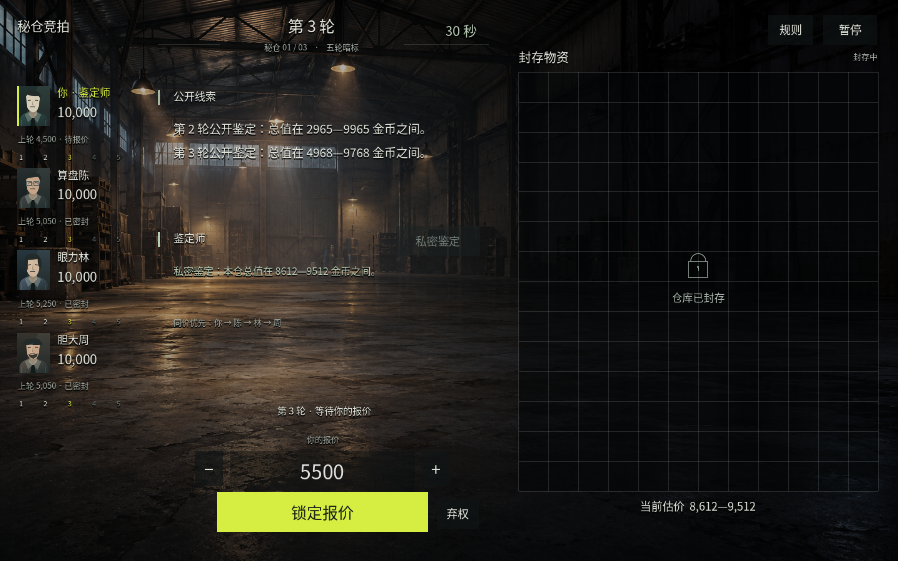
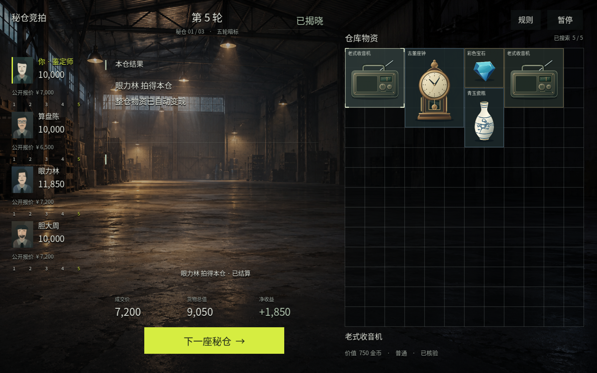

# AuctionMaster · 秘仓竞拍

一个完整的 Godot 4.7.2 中文 2D 仓储竞拍小游戏：1 位真人对阵 3 位 AI，探索封存仓库，通过公开线索、私有鉴定和五轮暗标判断货物价值。无需插件、联网或外部服务。

## 实机画面

以下为同一游戏主场景在 Godot 4.7.2 中的原生渲染截图（脚本驱动示例局面，未进行图像合成）。截图与界面验证方式见下方测试说明。





## 参考与原创边界

题材最初参考小黄纸片厂《拍卖之王》的公开简介：[TapTap 页面](https://www.taptap.cn/app/831325)。本次界面结构按用户指定的《竞拍之王》BidKing 的[官方 Steam 实机截图](https://store.steampowered.com/app/4128580/)重新设计：全幅仓库环境、左侧窄玩家列表、浮动信息、右侧细密纵向库存和底部亮色出价按钮。另借鉴二维物资搜索中“网格占用、逐件搜索、选中详情”的通用交互。没有复制任何参考游戏的人物、品牌、背景、贴图或具体玩法规则；本项目不是官方作品、续作或完整复刻。

下面的经济系统、成交方式、优先权、AI 策略、估价线索、角色及原创美术都是本项目的独立设计。暂时仅支持本地单人，不提供真实联机。没有真钱、支付、交易或账号。

## 运行

1. 用 **Godot 4.7.2** 打开 `project.godot`。
2. 点击运行项目（F6 仅运行当前场景，推荐 F5）。入口是 `scenes/main.tscn`。
3. 主菜单可选择每轮 15 / 30 / 60 秒，默认 30 秒。

默认窗口 1280 × 800；逻辑画布 1440 × 900。使用 GL Compatibility 渲染器。字体已附带，中文显示不依赖系统字体。

## 本项目规则

- 一场 **3 个仓库**，每仓 **固定 5 轮**，4 人各有 **10,000 虚拟金币**。
- 每轮同时暗标：玩家提交前，3 位 AI 已独立锁价；你提交后一起公开该轮报价。
- 本轮新报价**替换**上一轮，不累计，不要求递增。锁定后不可修改；超时自动提交 0。0 表示本轮弃权。
- 前 4 轮只收集信息，不成交、不扣款。只有第 5 轮最高报价决定成交。
- 最高报价相同，按已公开的轮换优先权：第 1 仓从玩家开始，第 2 仓从算盘陈开始，第 3 仓从眼力林开始，循环其余席位。全员为 0 时流拍。
- 赢家只支付**一次最终成交价**，整仓货物自动按真实货值变现。资金变化 = 货值 − 成交价；其余人不扣钱。
- 每轮增加公开估价线索；鉴定师技能每仓仅一次，提供只对自己可见的更窄估价区间。区间真实且随机偏移，中点不等于已知真实货值。
- 三仓后按剩余资金排名；资金相同共享同一名次（例如 1、1、3、4）。没有早落槌规则。

### 仓储搜索

右侧为 **12×14（168 格）**的纵向仓储网格，单格逻辑尺寸 48px；相较旧版 10×6 的 80px 格子更细密。全屏二维仓库背景贯穿界面，库存使用透明底与共享细线，玩家、线索、选中详情直接浮在场景上，不再使用左右大型卡片、顶部外框或底部操作面板。竞拍中全仓统一封存，不通过占格轮廓泄露实际数量、种类、尺寸或价值。第五轮结束时先由会话一次性完成成交结算，再播放逐件搜索动画；搜索与“完成搜索”按钮不会改变资金。每仓仍为原规则的 3–5 件真实物资，不为填格添加虚假藏品或修改货值分布。公开物资按 2×2、2×3、3×2、3×3、3×4 的展示占格紧凑拼箱；更细的格子对应更细的展示单位，不改变物品价值。格内显示薄品质边与名称，点击已发现物资可在网格下沿查看价值和品质。品质仅按单件估值区间作视觉分级，不增加额外价格或规则。

开仓后报价表单切换为成交价、货物总值与净收益，浮动线索切换为本仓赢家概览。搜索支持暂停与跳过，也可直接进入下一仓。搜索进度由主循环驱动，不使用异步计时器；切仓与重开会清空旧进度和选择，旧动画不会污染新仓库。

### 操作

输入框输入非负整数；`− 500` / `+ 500` 快调；Enter 锁定；“本轮弃权”提交 0。非法、负数、小数、超预算与重复/过期报价会被拒绝。换阶段按钮防双击透传，避免“下一仓”的第二次点击意外提交新仓报价。Esc 暂停/继续；窗口失焦自动暂停。暂停时计时停止。重新开始有确认页。

## 架构及接入接口

- `scripts/rules.gd`：独立 Resource 规则配置，`rounds`、`warehouses`、`initialcoins`、`round_seconds`。
- `scripts/session.gd`：权威会话模型，生成隐藏库存、管理阶段、校验提交、结算和排名。
- `scripts/bid_ai.gd`：纯观察输入的 AI，无法访问 Session 或隐藏库存。
- `scripts/main.gd`：二维全幅竞拍界面、输入、菜单、暂停及状态呈现。
- `scripts/warehouse_view.gd`：纯 Control 二维 12×14 仓储网格，只接受权限快照；竞拍期间不持有物品、占格、数量或真实价值，整个仓库统一遮罩。开仓后使用确定性无重叠布局、逐件发现动画、品质边条和物品选择。

可供以后 Party 系统调用的边界（当前不是网络协议）：

```gdscript
var session = preload("res://scripts/session.gd").new()
session.start(seed_value) # -1 随机，固定 seed 可复现
var observation = session.snapshot(player_id) # 深拷贝的权限视图
var accepted = session.submit_bid(player_id, amount, expected_warehouse, expected_round)
session.tick(delta)       # 当前回合计时；暂停时宿主不调用
session.advance()         # round_result -> 下一轮；reveal -> 下一仓/finished
session.use_skill(player_id)
var items = session.reveal_items() # 揭仓前为 []
var total = session.total_value()  # 揭仓前为 0
var ranking = session.rankings()
```

阶段：`bidding` → `round_result` → `bidding`，第 5 轮直接进入 `reveal`，最后一仓确认后进入 `finished`。`snapshot()` 包括阶段、资金、线索、历史、自己的报价与鉴定、优先权；当前其他人的密封报价不会暴露。轮后提供 `round_bids`，揭仓后才提供 winner/price；库存与真实总值仅在 reveal/finished 阶段进入快照；竞拍渲染器不访问 Session 或隐藏库存。

当前会话固定把席位 1–3 作为 AI，席位 0 为真人。未来接入联机需要由服务器认证玩家身份、移除/替换 AI 自动提交，并保持这套权威校验；不能把 GDScript 的下划线字段当作进程内安全沙箱。

### AI 公平性

AI 只接收脱敏字典：资金、公开估价、历史公开报价等。报价在玩家输入前生成。三种风险系数和有限随机扰动模拟稳健、价值、冒险倾向，并参考上一轮最高报价发现价格。所有 AI 都不知道真实库存与精确货值，也不能看到玩家私有鉴定。没有根据玩家当前报价追价的作弊逻辑。公开线索和私有技能使用分离随机源，使用技能不会重抽 AI 当前报价。

## 测试

```sh
GODOT=/path/to/Godot_v4.7.2-stable_linux.x86_64 ./tests/run_tests.sh
```

测试包括：非法/超预算输入、重复/过期请求、报价替换、超时、技能私有与一次限制、AI 预先锁价/信息隔离、流拍、轮换同价优先、一次支付、资金变化核算、并列名次、完整三仓、重开及 UI 集成流程。`qa_rules.gd` 是独立规则审查，包含 500 个 seed 的完整场次验证。`qa_inventory_privacy.gd` 使用相同公开资料、不同隐藏货物验证界面不泄露；`qa_inventory_grid.gd` 覆盖占格边界/无重叠、逐项揭晓、不可提前选取、跳过幂等、暂停/失焦、半途重开及快速切仓。`qa_dense_layout.gd` 另外覆盖 1,000 个 seed 的全部三仓密格布局、逐件搜索、伪造密封库存拒绝，以及主菜单、竞拍、结算、暂停、排名等状态的文字边界和最大正常资金显示。原生 GUI 另外检查字体、视图、交互和布局；不同隐藏库存但相同公开资料的密封界面也进行逐像素渲染对比。

## 资产及许可

本项目源码和原创二维美术：MIT，见 `LICENSE`。金条、瓷瓶、座钟、收音机、宝石和四名竞拍者头像为本项目原创 SVG 插画。全幅仓库背景为本项目生成的原创二维场景，来源说明见 `assets/backgrounds/README.md`。背景只是二维图片，不构建三维仓库或物品场景。网格与界面由 Godot 原生二维绘制，没有使用参考游戏的人物、贴图、音效或品牌素材。

`assets/fonts/NotoSansCJK.ttc`：Noto CJK 字体，SIL Open Font License 1.1。完整随附版权及许可文字见 `assets/fonts/LICENSE.txt`，第三方说明见 `THIRD_PARTY_NOTICES.md`。不需要联网下载字体。项目暂未添加音效。
